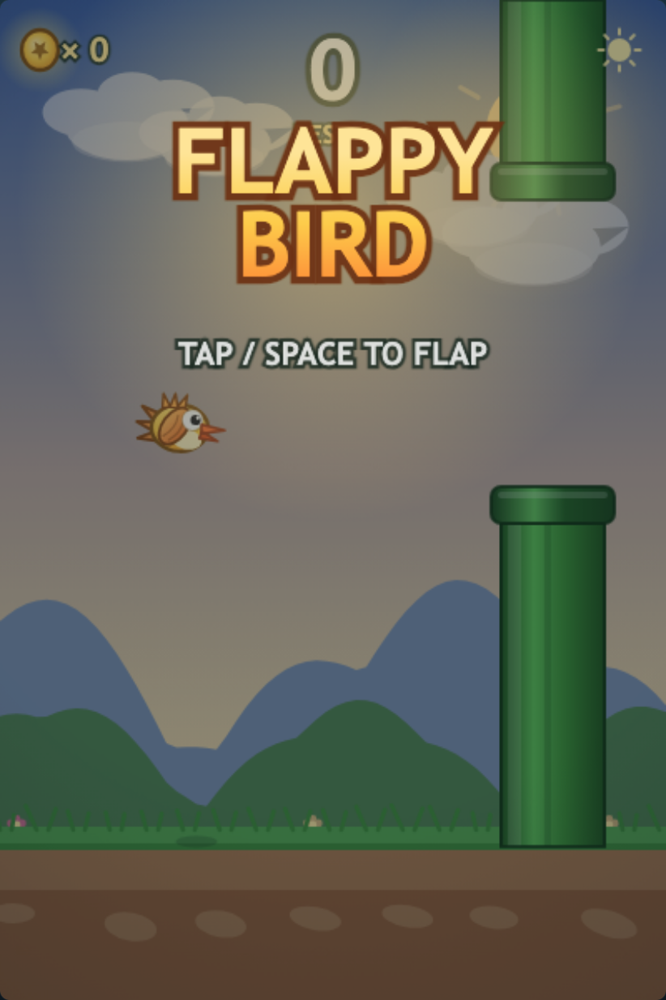
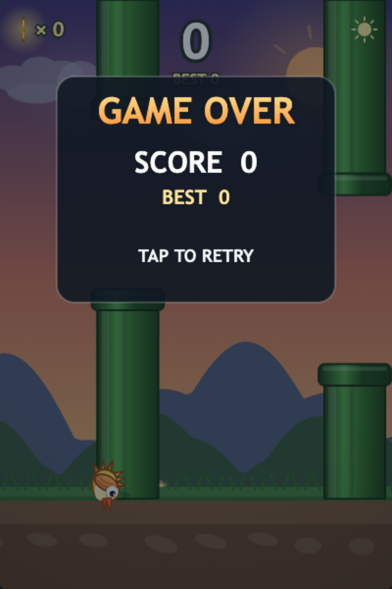

# LLMPlayground
To try out initially stuff with local agents.

## Flappy Bird

A self-contained Flappy Bird game built with plain HTML5 canvas — no dependencies.

- Open `index.html` in any browser, or play it live at https://adityakompella6.github.io/LLMPlayground/ (GitHub Pages).
- Play: tap, click, or press **Space** / **↑** / **W** to flap. Avoid the pipes and the ground.
- Features: golden coin pickups (+1 bonus score), a day-to-night cycle (sun → sunset → stars & moon → dawn), particles (feathers, sparkles, dirt), screen shake, floating score popups, and a pop-in game-over panel.
- Score, best score, and coins are tracked locally in your browser.

### Screenshots

| Ready | Playing | Game over |
| ----- | ------- | --------- |
|  |  |  |
