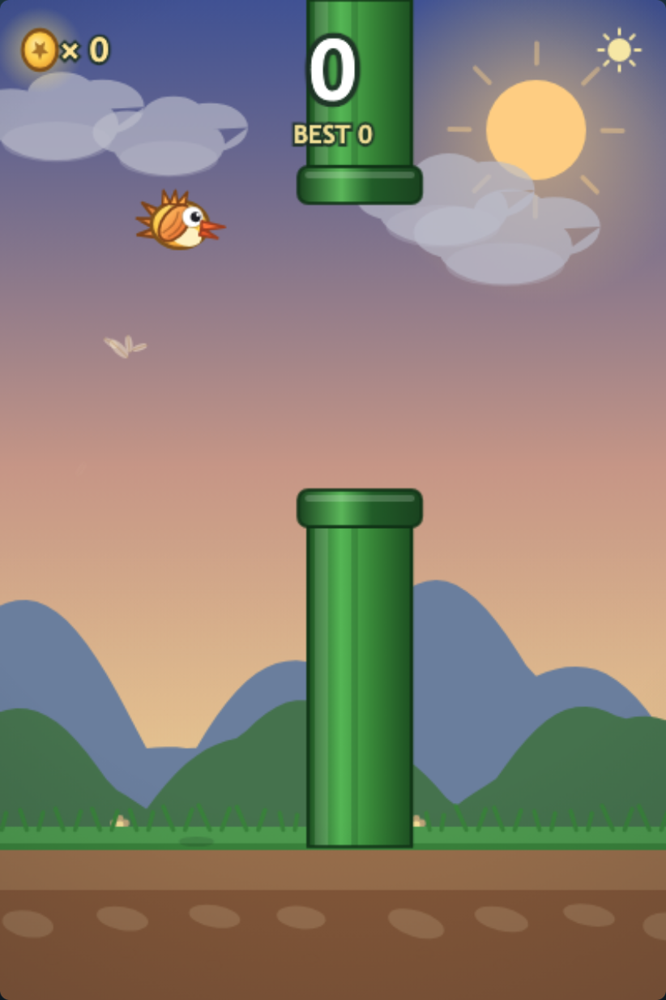
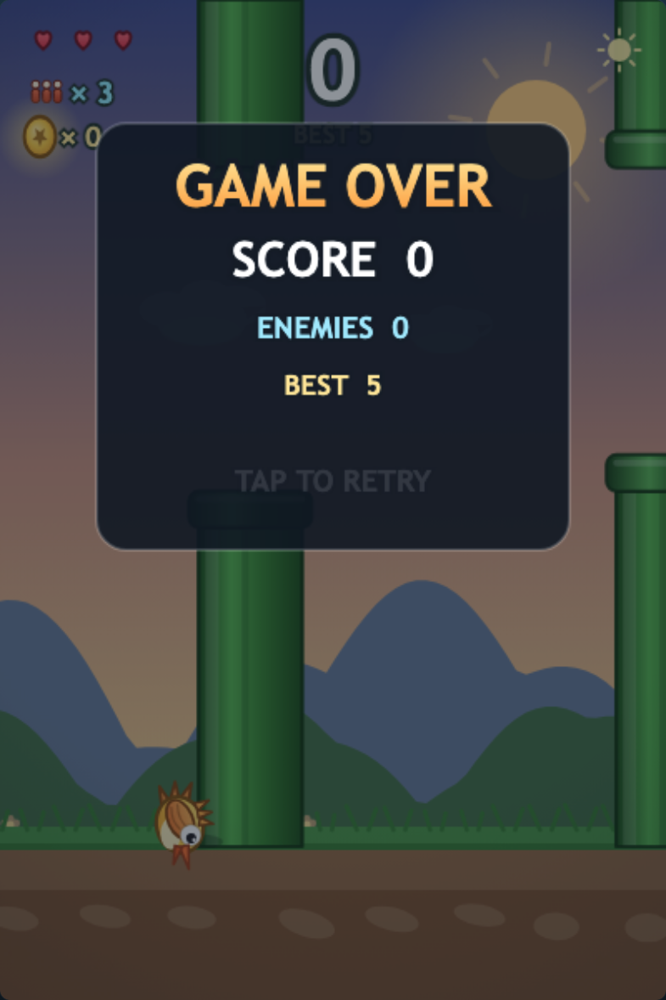
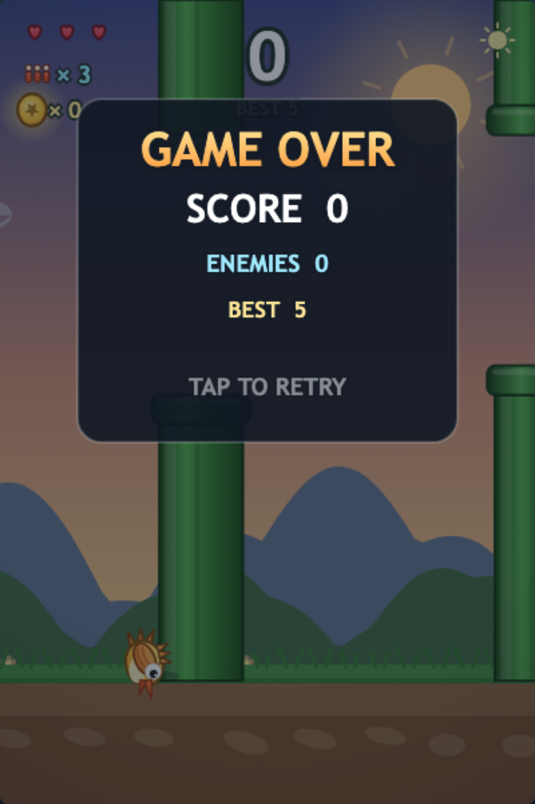

# LLMPlayground
To try out initially stuff with local agents.

## Flappy Bird

A self-contained Flappy Bird game built with plain HTML5 canvas — no dependencies.

- Open `index.html` in any browser, or play it live at https://adityakompella6.github.io/LLMPlayground/ (GitHub Pages).
- Play: tap, click, or press **Space** / **↑** / **W** to flap. **Avoid the pipes and the ground.**
- Fight: bats and hawks fly in from the right. Dodge them (they cost a heart on contact) or press the **⚔ fire button**, **Z** / **X** / **J** / **Q**, or right-click to auto-aim and shoot one with a laser for the +2 kill bonus.
- Ammo drops inside the pipes (grab up to 12; start with 3). Hearts: you start with 3, get 1.5s of invulnerability after spawn and a brief grace period after each hit.
- Features: golden coin pickups (+1 bonus score), enemy waves and +2 per kill, laser auto-aim with muzzle flash and beam, ammo pickups with a running tally, day-to-night cycle (sun → sunset → stars & moon → dawn), particles (feathers, sparkles, dirt), screen shake, floating score popups, and a pop-in game-over panel.
- Best score is saved locally in your browser.

### Screenshots

| Ready | Playing | Enemies incoming | Laser attack | Game over |
| ----- | ------- | ---------------- | ------------ | --------- |
|  |  |  |  |  |
